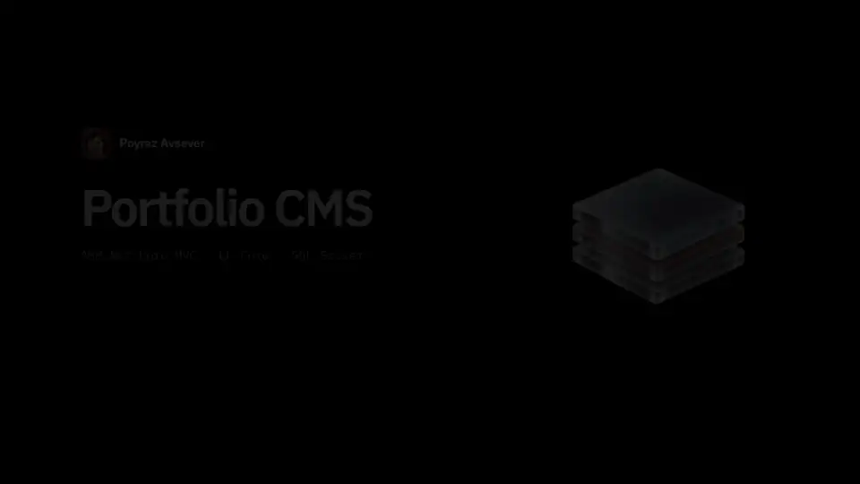
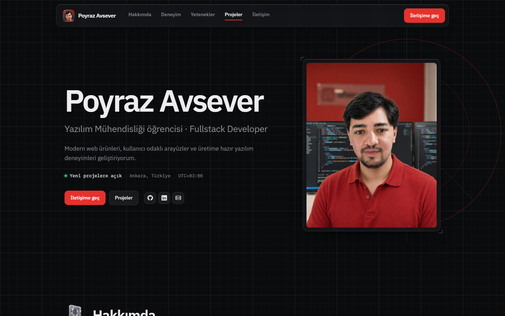
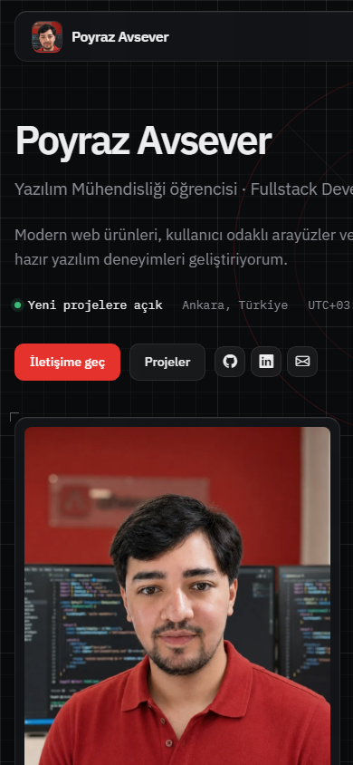
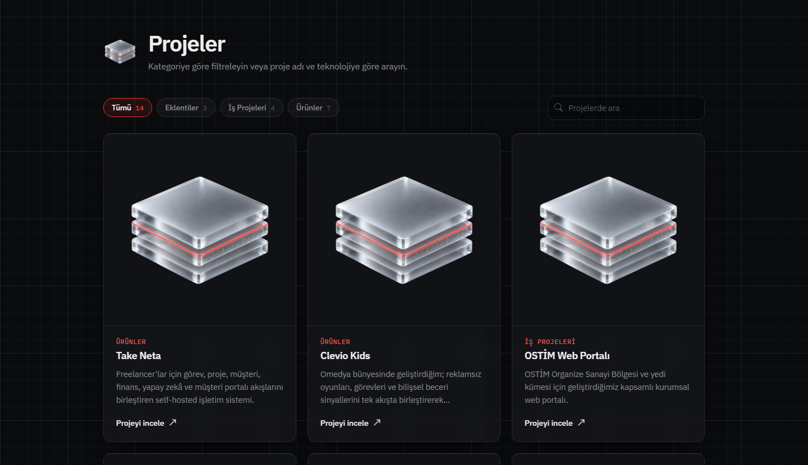
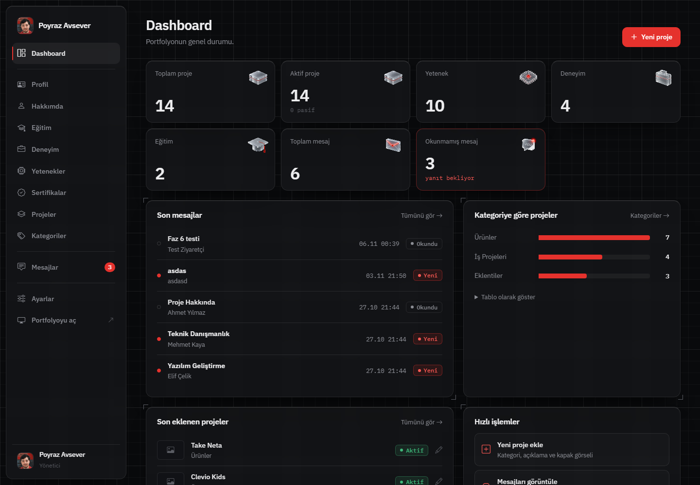
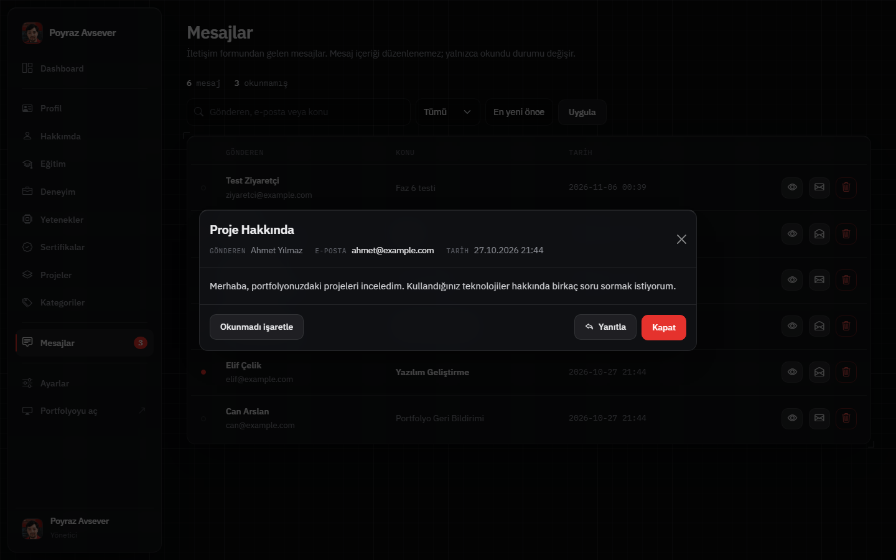
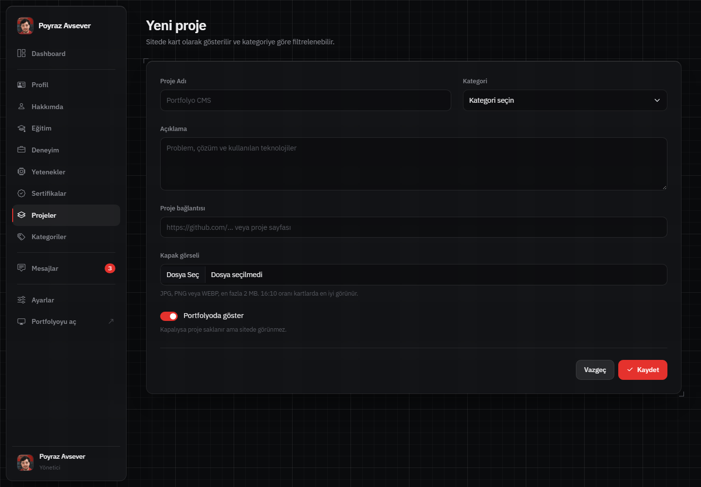

# Poyraz Avsever · Portfolyo ve Yönetim Paneli

ASP.NET Core MVC (.NET 10) ve Entity Framework Core ile geliştirilmiş, tüm içeriği bir yönetim panelinden düzenlenebilen kişisel portfolyo sitesi.
M&Y Yazılım Eğitim Akademi · 12. Dönem Akşam Grubu · **1. Proje: Portfolyo Case** çalışması olarak hazırlandı.

**Canlı:** https://myportfolio.poyrazavsever.com



<sub>40 saniyelik tanıtım · İngilizce seslendirmeli sürüm: [docs/demo.mp4](docs/demo.mp4)</sub>

## Ekran görüntüleri

<table>
  <tr>
    <td width="72%"><br><sub>Ana sayfa</sub></td>
    <td width="28%"><br><sub>Mobil</sub></td>
  </tr>
</table>

| Projeler (kategori filtresi ve arama) | Dashboard |
|---|---|
|  |  |

| Gelen kutusu (modal detay) | Proje formu |
|---|---|
|  |  |

## Öne çıkanlar

- **Tamamen dinamik içerik:** Ana sayfadaki her bölüm (hero, hakkımda, deneyim, eğitim, yetenekler, projeler, sertifikalar, iletişim) veritabanından gelir ve admin panelinden yönetilir. Pasif kayıtlar sitede görünmez.
- **İlişkili veri:** Kategori ↔ Proje bire-çok ilişkisi, veritabanından gelen kategori dropdown'u, sitede kategori filtresi ve proje araması.
- **Gelen kutusu:** İletişim formu doğrulanarak kaydedilir. Admin tarafında okundu/okunmadı takibi, arama, filtre, tarih sıralaması, Bootstrap Modal ile detay ve SweetAlert2 ile silme onayı vardır. Mesajın orijinal içeriği düzenlenemez.
- **CV indir:** Admin panelinden yalnızca PDF yüklenir (uzantı, MIME ve `%PDF` imzası kontrolü). Dosya `wwwroot` dışında saklanır ve yalnızca indirme action'ı üzerinden anlamlı bir adla sunulur.
- **Dashboard:** EF Core sorgularıyla üretilen istatistik kartları, son 5 mesaj, son 3 proje, kategori bazında proje grafiği ve hızlı işlemler.
- **Özgün arayüz:** Koyu, cam (glassmorphism) ve mühendislik temalı bir tasarım sistemi. Bölüm ikonları Higgsfield ile üretilip ffmpeg ile alfa kanallı WebM'e dönüştürülen hareketli cam ikonlar.

## Teknolojiler

| Katman | Kullanılan |
|---|---|
| Backend | ASP.NET Core MVC (.NET 10), Areas, View Components, Tag Helpers |
| Veri | Entity Framework Core 10 (Code First, migrations), SQL Server LocalDB |
| Validasyon | Data Annotations, `ModelState`, jQuery Validation Unobtrusive |
| Arayüz | Bootstrap 5.3 (CSS değişkenleriyle temalanmış), Bootstrap Icons, IBM Plex Sans/Mono |
| Bildirim | SweetAlert2 (onay ve toast), TempData |
| Tasarım varlıkları | Higgsfield (GPT Image 2.5 + MiniMax H3), ffmpeg, Pillow |

## Kurulum

**Gereksinimler:** .NET 10 SDK, SQL Server LocalDB (Visual Studio ile gelir) ve EF Core CLI aracı.

```bash
dotnet tool install --global dotnet-ef
```

```bash
git clone https://github.com/poyrazavsever/my-portfolio.git
cd my-portfolio/Portfolio
```

Veritabanını oluştur (bütün migration'lar uygulanır):

```bash
dotnet ef database update
```

Örnek içeriği yükle (profil, deneyim, eğitim, yetenek, sertifika, kategori ve projeler):

```bash
dotnet run -- --seed
```

Uygulamayı başlat:

```bash
dotnet run --launch-profile http
```

- Portfolyo: http://localhost:5000
- Yönetim paneli: http://localhost:5000/Admin

> Bağlantı ayarı `Portfolio/appsettings.json` içindeki `PortfolioConnection`'dadır. Seed komutu tekrar çalıştırılabilir; içerik tablolarını yeniden doldurur, gelen mesajlara ve yüklenen CV'ye dokunmaz.

## Case gereksinimleri

| # | Gereksinim | Nerede |
|---|---|---|
| 01 | Bütün içerik modülleri için CRUD; admin değişiklikleri sitede görünür | `Areas/Admin/Controllers/*` · `ViewComponents/DefaultViewComponents/*` |
| 01 | Ad, unvan, tanıtım, profil görseli ve sosyal bağlantılar dinamik; navigasyon bölümlere gider | Admin → Profil · `_DefaultHeroSectionComponentPartial` · scrollspy (`wwwroot/js/site.js`) |
| 01 | Deneyim/eğitim tarih sırasıyla; aktif/pasif renkli etiket; pasifler sitede gizli | `OrderByDescending(StartDate)` · `Where(IsActive)` · `.pa-badge` |
| 01 | Projeler kart olarak, yetenekler seviye ile; silme/düzenleme çalışır | `_DefaultProjectComponentPartial` · `_DefaultSkillComponentPartial` |
| 02 | Category ↔ Project bire-çok (FK + navigation property), kategori CRUD | `Entities/Project.cs` · `CategoryController` · silmede `Restrict` |
| 02 | Proje formunda DB'den dropdown, listelerde kategori adı, sitede kategori filtresi | `SelectList` + `asp-items` · `Include` · filtre çipleri |
| 03 | İletişim formu doğrulanır ve kaydedilir | `DefaultController.SendMessage` · `[Bind]` · honeypot |
| 03 | Okundu/okunmadı, arama, tarih sıralaması, okunmamış sayısı | `MessageController.MessageList` · sidebar rozeti |
| 03 | Bootstrap Modal ile detay, silmeden önce onay, içerik düzenlenemez | Modal + AJAX ile okundu · SweetAlert2 · düzenleme ekranı yok |
| 04 | CV indir: yalnızca PDF, sunucudaki konum ve admin'den güncelleme | `Services/CvStorage.cs` (`App_Data/cv`) · Admin → Ayarlar · `DownloadCv` |
| 05 | Dashboard: istatistikler, son 5 mesaj, son 3 proje, kategori özeti, hızlı işlemler | `DashboardController` + `DashboardViewModel` |
| 06 | Data Annotations + `ModelState.IsValid` | `Entities/*` |
| 06 | Bootstrap Modal, SweetAlert2, TempData | `wwwroot/js/admin-ui.js` · `Infrastructure/NotificationExtensions.cs` |
| 06 | Include, SelectList, Where, Count, OrderByDescending, Take, GroupBy | `ProjectController` · `DashboardController` |
| 06 | IFormFile ile görsel: tür/boyut kontrolü, benzersiz ad, wwwroot altında güvenli saklama | `Services/ImageStorage.cs` (magic bytes, Guid, `wwwroot/uploads`) |
| 07 | Migration dosyaları, örnek veriyle çalışan proje | `Portfolio/Migrations` · `Data/PortfolioSeeder.cs` |
| 07 | Ek UX geliştirmesi | Proje arama, boş liste mesajları, duyarlı tablolar, kategori grafiği, AJAX okundu, tarayıcıda dosya boyutu kontrolü |

## Proje yapısı

```text
Portfolio/
├── Areas/Admin/            Yönetim paneli (controller, view, view component, view model)
├── Controllers/            DefaultController (site, iletişim formu, CV indir), HomeController (hata sayfası)
├── Context/                PortfolioContext (DbSet'ler, Fluent API ile Restrict kuralı)
├── Data/                   PortfolioSeeder (dotnet run -- --seed)
├── Entities/               Code First entity'ler ve Data Annotations
├── Infrastructure/         TempData bildirimleri, ortak site sorguları
├── Migrations/             EF Core migration'ları
├── Models/                 Public site view model'leri
├── Services/               ImageStorage (görsel), CvStorage (PDF)
├── TagHelpers/             <glass-icon> Tag Helper
├── ViewComponents/         Ana sayfanın her bölümü için bir View Component
├── Views/                  Layout, bölüm view'ları, paylaşılan partial'lar
└── wwwroot/
    ├── assets/icons/       Hareketli cam ikonlar (WebM + PNG poster)
    ├── assets/brand/       Logo ve favicon seti
    ├── css/                design-system.css (token'lar) · site.css · admin.css
    └── js/                 site.js · admin-ui.js · glass-icon.js
design/icons/               İkon üretim hattı (icons.json + generate.py)
design/video/               Demo videosu üretim hattı (build.py)
docs/                       demo.webp · demo.mp4 · screenshots/
LEARNING_NOTES.md           Her fazda ne yaptık, neden yaptık
```

## Tasarım

- **Token tabanlı tema:** Bütün renk, cam yüzey, tipografi ve ölçü değerleri `design-system.css` içindeki `:root` değişkenlerinde. Bootstrap'ın `--bs-*` değişkenleri bu token'lara bağlı olduğu için modal, form ve offcanvas gibi bileşenler de aynı dili konuşuyor.
- **Kurallar:** Tek vurgu rengi (kırmızı `#E5322D`), gradyan yok, emoji yok, başlık üstü etiket yok. Mühendislik dili ızgara zemin, köşe işaretleri, cetvel göstergeleri ve mono tipografiyle kuruldu.
- **Hareketli cam ikonlar:** `design/icons/generate.py` tek bir prompt şablonuyla görsel üretir (GPT Image 2.5), görseli döngüsel olarak canlandırır (MiniMax H3) ve ffmpeg ile koyu arka planı silip alfa kanallı WebM'e çevirir. `<glass-icon>` Tag Helper'ı önce şeffaf PNG basar; destekleyen tarayıcılarda bunu videoya yükseltir (Safari'de ve "azaltılmış hareket" tercihinde PNG kalır).

## Yayın

Docker ile bir Linux sunucusunda çalışıyor ve Cloudflare Tunnel üzerinden yayınlanıyor; sunucuda dışarıya açık port yok.

- `Dockerfile`: çok aşamalı build, root olmayan kullanıcı. `deploy/compose.yaml`: uygulama + kalıcı volume'lar (yüklemeler, CV, Data Protection anahtarları).
- Veritabanı paylaşılan bir SQL Server 2022 konteynerinde; uygulama yalnızca kendi veritabanına yetkili ayrı bir kullanıcıyla bağlanıyor.
- Admin şifresinin yalnızca PBKDF2 hash'i ortam değişkeninde tutuluyor. Hash üretmek için: `dotnet run -- --hash-password`
- Yerel geliştirmede admin bilgisi repoda değil, **User Secrets**'ta: `dotnet user-secrets set "AdminAuth:Username" admin` ve `AdminAuth:PasswordHash` için `--hash-password` çıktısı.

## Güvenlik notları

- Veri değiştiren bütün işlemler POST ve `[ValidateAntiForgeryToken]` ile korunuyor; AJAX isteklerinde token header'da gönderiliyor.
- İletişim formunda `[Bind]` ile overposting koruması ve honeypot ile bot koruması var.
- Dosya yüklemede uzantı beyaz listesi, boyut sınırı ve dosya imzası (magic bytes) kontrolü yapılıyor; dosyalar Guid ile yeniden adlandırılıyor ve path traversal'a karşı kök klasör doğrulanıyor.
- `returnUrl` yönlendirmelerinde `Url.IsLocalUrl` ile open redirect engelleniyor.
- **Admin girişi:** Cookie tabanlı oturum (HttpOnly, SameSite=Lax, HTTPS'te Secure), PBKDF2 (210.000 tur) şifre hash'i, sabit zamanlı karşılaştırma ve IP başına dakikada 5 deneme sınırı.

## Öğrenme notları

Geliştirme 12 fazda ilerledi. Her fazda neyin, neden yapıldığı; karşılaşılan hatalar ve çözümleri [LEARNING_NOTES.md](LEARNING_NOTES.md) dosyasında.
